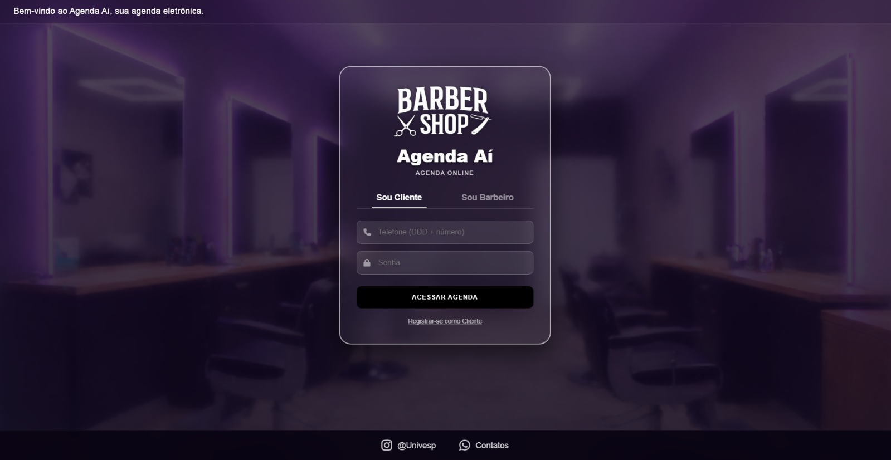
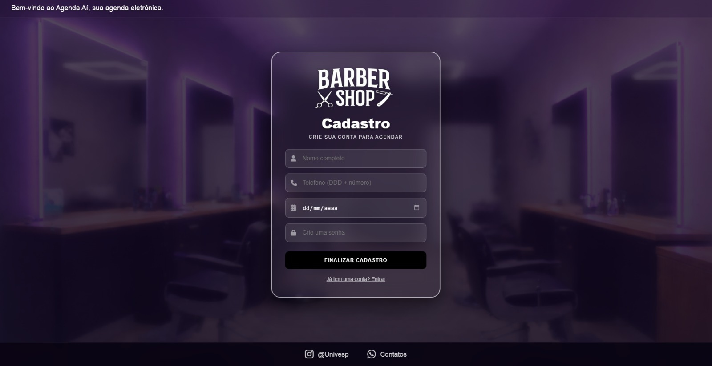

# 💈 Agenda Aí - Sistema de Agendamento para Barbearia

Projeto Integrador (PI) da **Univesp**. Aplicação web em **Python/Django** para agendamento de horários em barbearia: o cliente escolhe o serviço, o barbeiro, o dia e o horário, e o barbeiro administra a própria agenda.

🌐 **Aplicação no ar:** http://147.15.102.248

## 🚀 Funcionalidades

**Já disponíveis**
- **Login e cadastro** separados para clientes e barbeiros
- **Painel do cliente:** novo agendamento e "Meus agendamentos"
- **Horários livres sem recarregar a página:** a tela de agendamento busca os horários disponíveis no servidor com JavaScript
- **Painel do barbeiro:** visualização da agenda e confirmação de agendamentos

**Em desenvolvimento (entrega em 06/11/2026)**
- Barbeiro define os dias e horários em que trabalha e liga ou desliga a própria agenda
- Agendamento em etapas (serviço → barbeiro → dia → horário), mostrando só o que está disponível
- Acessibilidade em todas as telas: botões para aumentar e diminuir o tamanho da letra

## 🛠️ Tecnologias

| Camada | Tecnologia |
| --- | --- |
| Backend | Python 3 e Django 4.2 |
| Frontend | HTML5, CSS3, JavaScript e FontAwesome |
| Banco de dados | MySQL 8.0 no servidor; SQLite no desenvolvimento local |
| Servidor | Docker Compose, Gunicorn e Nginx numa VM da Oracle Cloud |

## 🔧 Como rodar na sua máquina

Não é preciso instalar MySQL nem Docker: localmente o projeto usa SQLite.

**1. Baixe o projeto**
```bash
git clone -b integracao-oracle https://github.com/rafaellamego/projeto-barbearia-django.git agenda-ai
cd agenda-ai
```

**2. Crie o ambiente e instale as dependências**

Windows:
```bash
python -m venv venv
venv\Scripts\activate
pip install -r requirements.txt
copy .env.example .env
```

Linux ou Mac:
```bash
python3 -m venv venv
source venv/bin/activate
pip install -r requirements.txt
cp .env.example .env
```

**3. Edite o arquivo `.env`**, mudando duas linhas:
- `DJANGO_DEBUG=False` → `DJANGO_DEBUG=True`
- `# DB_ENGINE=sqlite` → `DB_ENGINE=sqlite`

**4. Crie o banco e rode**
```bash
python manage.py migrate
python manage.py loaddata inicial.json
python manage.py runserver
```

Acesse http://127.0.0.1:8000. Usuário de teste: telefone `15900020002`, senha `cliente`.

## 🤝 Como a equipe trabalha

- O **GitHub é a única fonte do código**. Só o responsável pelo servidor atualiza a VM da Oracle, a partir do branch `integracao-oracle`.
- Sempre `git pull` antes de começar.
- Cada equipe trabalha no seu branch (`equipe-barbeiro`, `equipe-cliente`, `equipe-agendamento`) e envia as mudanças por pull request para o `integracao-oracle`.
- Mudanças no `models.py` são combinadas no grupo antes. Quem altera um model gera a migração e envia as duas coisas juntas.
- Nunca envie o `.env`, a pasta `venv` ou o `db.sqlite3`.

## 📸 Demonstração do Sistema

### Tela de Login (Cliente / Barbeiro)


### Tela de Cadastro (Usuário)

